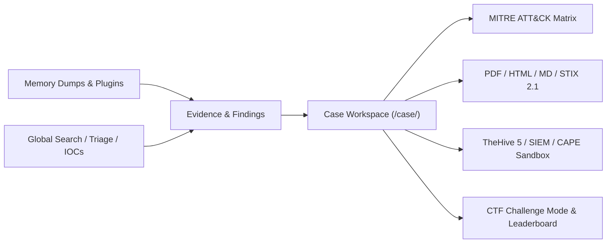
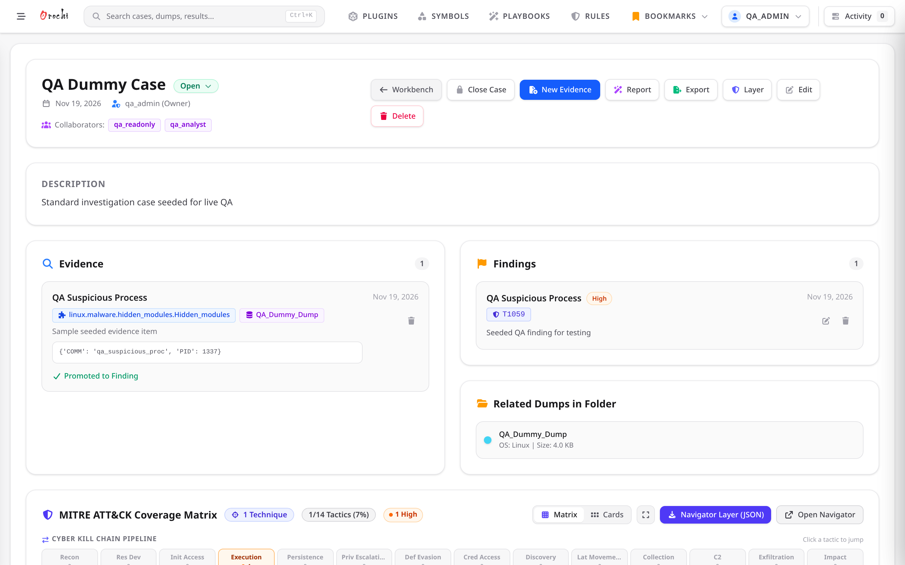
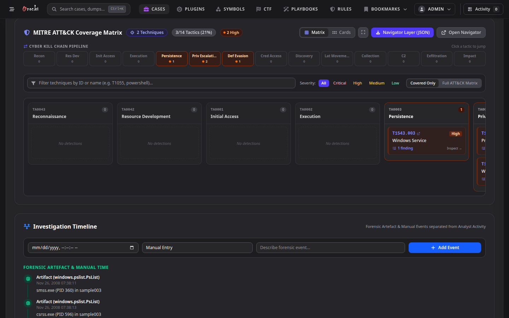
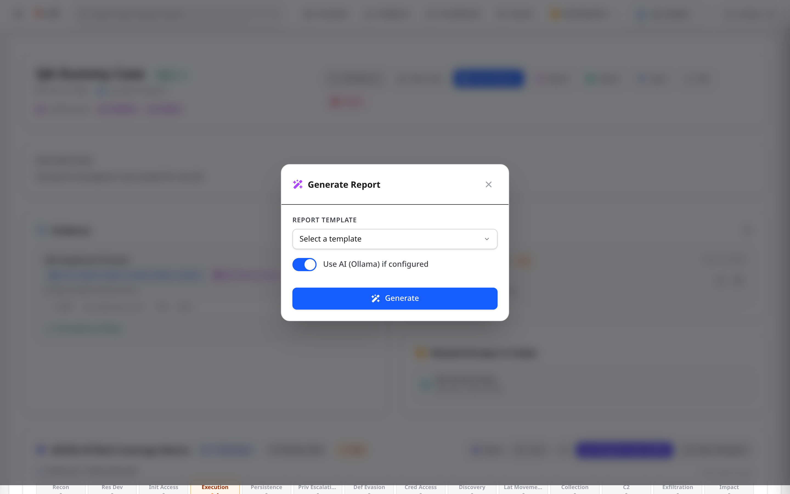
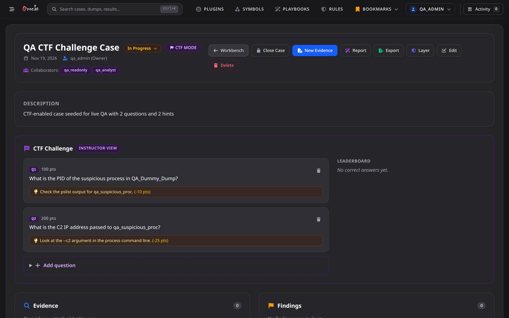
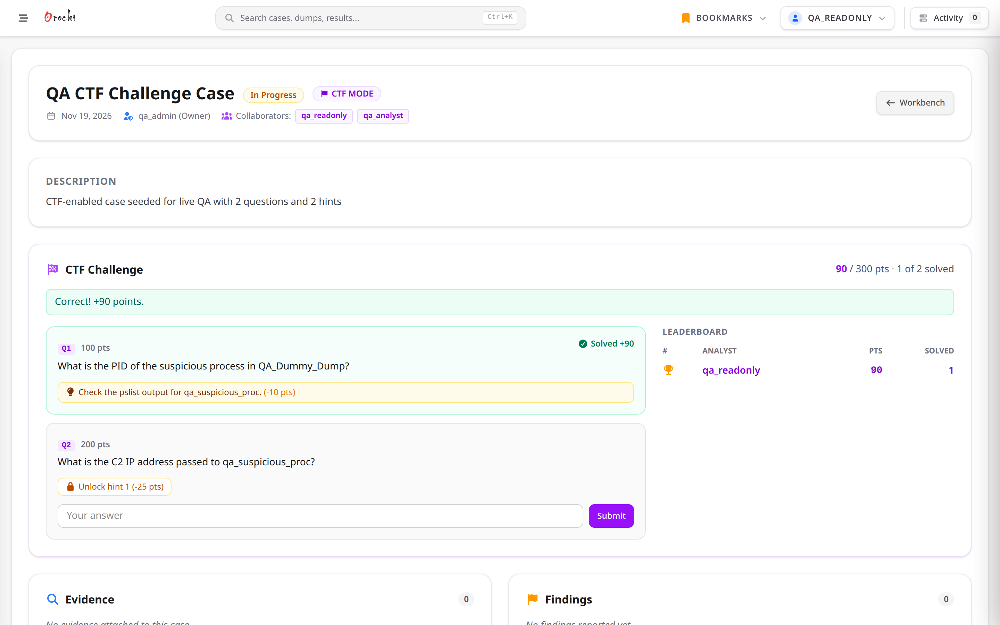

# Orochi Cases & CTF Mode Guide

_Version 2.7.0 — 2026_  
_End-to-End Investigation Management, External IR Integrations, and Graded CTF Training Exercises_

---

## Table of Contents

- [Overview](#overview)
- [Case Management Workflow](#case-management-workflow)
  - [1. Creating, Editing & Changing Case Status](#1-creating-editing--changing-case-status)
  - [2. Collaboration & Access Control](#2-collaboration--access-control)
  - [3. Collecting Evidence & Promoting Findings](#3-collecting-evidence--promoting-findings)
  - [4. MITRE ATT&CK Coverage Matrix & Navigator Export](#4-mitre-attck-coverage-matrix--navigator-export)
  - [5. Multi-Host Graph, Timeline & Real-Time Presence](#5-multi-host-graph-timeline--real-time-presence)
- [Case Reporting & External Integrations](#case-reporting--external-integrations)
  - [Interactive Case Report Modal & AI Summaries](#interactive-case-report-modal--ai-summaries)
  - [Multi-Format Export (`.tar.gz` Bundle, PDF, Markdown, HTML, STIX 2.1)](#multi-format-export-targz-bundle-pdf-markdown-html-stix-21)
  - [TheHive 5 & SIEM Forwarding](#thehive-5--siem-forwarding)
  - [CAPE / Cuckoo Sandbox Submission](#cape--cuckoo-sandbox-submission)
- [CTF Challenge Mode (Graded Training Exercises)](#ctf-challenge-mode-graded-training-exercises)
  - [Roles & Permissions in CTF Mode](#roles--permissions-in-ctf-mode)
  - [Instructor Walkthrough (Case Owner / Superuser)](#instructor-walkthrough-case-owner--superuser)
  - [Solver Walkthrough (Students & Collaborators)](#solver-walkthrough-students--collaborators)
  - [Scoring, Hints & Anti-Brute-Force Rules](#scoring-hints--anti-brute-force-rules)
  - [Managing CTF Challenges via Django Admin & REST API](#managing-ctf-challenges-via-django-admin--rest-api)

---

## Overview

Orochi's **Cases** workspace turns individual memory dump plugin results into structured, collaborative digital forensic investigations — and doubles as a **graded Capture-The-Flag (CTF) training platform** for memory forensics courses and incident-response drills.



---

## Case Management Workflow

### 1. Creating, Editing & Changing Case Status

Cases are listed in the left sidebar under **Cases** and opened at `/case/<pk>`:

1. Click the **➕** button next to **Cases** (`/case_create`) to open the creation modal.
2. Enter a **Name**, optional **Folder**, **Description**, **Status** (`Open`, `In Progress`, `Closed`), **Collaborators**, and optionally enable the **CTF** flag.
3. From the case header (`/case/<pk>`), click **Edit** (`/case_edit`) to update metadata or collaborators, use the status badge dropdown (`/case_change_status/<pk>`) to transition status, or click **Delete** (`/case_delete/<pk>`) to remove the case.



### 2. Collaboration & Access Control

| Capability | Case Owner / Superuser | Collaborator (`Analyst` / `Reviewer`) | Collaborator (`ReadOnly`) | Non-Member |
| :--- | :---: | :---: | :---: | :---: |
| View Case, Evidence, Findings & Timeline | ✅ | ✅ | ✅ | ❌ (404/403) |
| Edit Case, Add/Edit/Delete Evidence & Findings | ✅ | ✅ | ❌ (403) | ❌ |
| Add/Edit Collaborative Notes | ✅ | ✅ | ❌ (403) | ❌ |
| Export Reports (PDF / HTML / MD / STIX / MITRE) | ✅ | ✅ | ✅ | ❌ |
| Forward to SIEM / Export to TheHive / Submit to Sandbox | ✅ | ✅ | ❌ (hidden / 403) | ❌ |
| Create or Delete CTF Questions | ✅ | ❌ (403) | ❌ (403) | ❌ |
| Submit CTF Answers, Unlock Hints & View Leaderboard | ✅ | ✅ | ✅ | ❌ |

> 🔒 **RBAC 403 Enforcement:** Authenticated users who lack permission for an action receive an explicit **HTTP 403 Forbidden** response (via `role_required` / `is_not_readonly`) rather than a login redirect.

### 3. Collecting Evidence & Promoting Findings

You can attach forensic artifacts to a case from four places across Orochi:

- **Case Detail Workspace (`/case/<pk>`)**: Click **Add Evidence** (`/evidence_create`) to link a memory dump, extracted file, or plugin result, then add one or more structured **Findings** (`/finding_create/<evidence_pk>`) with **Severity** (`Low`, `Medium`, `High`, `Critical`), Markdown **Notes**, **Tags**, and **MITRE ATT&CK** technique IDs.
- **Cross-Dump Global Search (`/global_search`)**: Click **Add to Case** (`/add_to_case_from_search`) on any search match to create evidence directly inside a target case.
- **Triage, Secrets & IOC Hubs**: Click **Add to Case** (`/promote_to_finding` or `POST /api/dumps/promote_finding`) to escalate behavioral detections, leaked credentials, or malicious IOCs into pre-populated case findings.
- **Plugin Result Row Annotations (`/value_annotations/<value_id>`)**: Annotate individual plugin rows with triage statuses (`Under Review`, `Suspicious`, `Verified Threat`, `Benign`) and escalate confirmed threats into the active case.


### 4. MITRE ATT&CK Coverage Matrix & Navigator Export

As findings are tagged with MITRE ATT&CK technique IDs (e.g., `T1055`, `T1059.001`, `T1036.005`), Orochi automatically populates an interactive **MITRE ATT&CK Coverage Matrix** inside the case workspace.

- Click **Export MITRE Layer** (`/case_mitre_export/<pk>`) to download a JSON layer compatible with the official [MITRE ATT&CK Navigator](https://mitre-attack.github.io/attack-navigator/).



### 5. Multi-Host Graph, Timeline & Real-Time Presence

- **Cross-Dump Multi-Host Forensic Graph**: Correlates processes, listening sockets, and memory injections across all dumps linked to the case (`POST /api/cases/{id}/graph/build`, `GET /api/cases/{id}/graph/`).
- **Unified Case Timeline**: Aligns events from Windows, Linux, and macOS captures into a single chronological sequence (`GET /api/cases/{id}/timeline/`).
- **Collaborative Notes & Live Presence**: Real-time analyst presence is broadcast over WebSockets (`wss://<host>/ws/case/{case_id}/presence/`), paired with shared Markdown notes (`GET/POST /api/cases/{id}/notes/`).

---

## Case Reporting & External Integrations

### Interactive Case Report Modal & AI Summaries

Click **Generate Report** in the case header (`POST /case_report/<pk>`) to render a formatted report from any installed HTML or DOCX `ReportTemplate` (seed defaults with `python manage.py seed_report_templates`):

1. Choose a **Report Template** (HTML or DOCX).
2. Optionally toggle **Generate AI Summary with Ollama** (when the **Ollama** service is configured under **Admin -> Services**).
3. Orochi compiles the case metadata, evidence, findings, MITRE techniques, and optional local LLM executive summary (`{{ ai_summary }}` / `{{ ai_summary_html }}`) without sending data to any external cloud.



### Multi-Format Export (`.tar.gz` Bundle, PDF, Markdown, HTML, STIX 2.1)

In addition to the downloadable **`.tar.gz` Case Bundle** (`/case_export/<pk>`) and **MITRE ATT&CK Navigator JSON layer** (`/case_mitre_export/<pk>`), the REST API exports publication-ready dossiers:

```bash
# Publication-ready PDF (WeasyPrint)
curl -k -H "Authorization: Bearer oro_..." "https://localhost/api/cases/1/export?format=pdf" -o case_1.pdf

# Technical Markdown, standalone HTML, or OASIS STIX 2.1 bundle
curl -k -H "Authorization: Bearer oro_..." "https://localhost/api/cases/1/export?format=markdown" -o case_1.md
curl -k -H "Authorization: Bearer oro_..." "https://localhost/api/cases/1/export?format=html" -o case_1.html
curl -k -H "Authorization: Bearer oro_..." "https://localhost/api/cases/1/export?format=stix" -o case_1_stix.json
```

### TheHive 5 & SIEM Forwarding

When configured under **Admin -> Services** (see [Services and MaxMind Guide](Services-and-MaxMind-Guide.md#siem-thehive-and-cape-sandbox)), two action buttons appear in the case header for non-ReadOnly users:

- **TheHive** (`POST /api/cases/{id}/export/thehive?push=true`): Creates a TheHive 5 case where findings become tasks, MITRE techniques become tags, and dump IOCs become observables. Pass `push=false` via API to preview the payload without pushing.
- **SIEM** (`POST /api/cases/{id}/siem/forward`): Forwards case findings (with severity and MITRE tags) and up to 200 IOCs to **Splunk HEC**, **Elastic**, or **Microsoft Sentinel**.

### CAPE / Cuckoo Sandbox Submission

When a **CAPE / Cuckoo Sandbox** service is configured in **Admin -> Services**:

1. Every plugin result row with an extracted binary (e.g., `windows.dumpfiles`, `windows.pslist --dump`, `windows.malfind`) shows a **Send to sandbox** flask icon beside its download button.
2. Case evidences referencing an extracted file also display a **Sandbox** button on the case detail page.
3. Clicking the button opens the **Sandbox Submit** modal (`/sandbox_submit`) where you can optionally specify an analysis VM (`machine`) and comma-separated `tags`.
4. After submission, the modal displays the created `task_id` and a direct link to the CAPE analysis task.
5. **Security Boundary**: Orochi strictly validates that the submitted file resides inside `<MEDIA_ROOT>/<dump_index>/` — any path outside the dump folder (or submitting when no CAPE service is configured) is rejected with HTTP `400`. `ReadOnly` users do not see the button and receive `403` on the API (`POST /api/dumps/{index}/sandbox/submit`).

---

## CTF Challenge Mode (Graded Training Exercises)

**CTF Mode** (`is_ctf=True`) transforms any Orochi case into an interactive, graded memory forensics exercise with questions, point-cost hints, answer hashing, brute-force throttling, and a live leaderboard.

### Roles & Permissions in CTF Mode

- **Instructor** (`can_manage`): The **Case Owner** (`case.user`) or any **Superuser**. Can create and delete questions, sees all hint texts automatically, and monitors the live leaderboard.
- **Solver** (Student / Trainee): Any user added to the case's **Collaborators** list — including **`ReadOnly` users**, making it safe to run classroom exercises where students can inspect memory dumps and plugin outputs without modifying dumps or running heavy plugins.

### Instructor Walkthrough (Case Owner / Superuser)

1. **Prepare the Case**: Create a case, attach the target memory dump(s) (via folder or evidence), add your students as **Collaborators**, and tick **CTF** in the case create/edit modal (or simply add your first question, which automatically enables `is_ctf=True`).
2. **Open the CTF Challenge Panel**: Open `/case/<pk>` (the panel loads from `/case/<pk>/ctf`).
3. **Add Questions** (`/case/<pk>/ctf/questions`):
   - **Question text**: The forensic question (e.g., *"Which external IP address is the C2 server?"*).
   - **Expected answer**: Normalized by stripping leading/trailing whitespace and lowercasing, then stored strictly as a **SHA-256 hash**. Plaintext answers are never persisted and cannot be read back.
   - **Points**: Base score awarded on a correct answer (default `100`).
   - **Order**: Display sequence number (default `1`).
   - **Hints** (optional, one per line): Use `cost | hint text` (e.g., `25 | Check windows.netscan ForeignAddr`). If no cost prefix is given, the hint defaults to `10` points.
4. **Manage Questions**: The instructor view shows every hint in clear text and a **Delete** button per question (`/case/<pk>/ctf/questions/<question_id>/delete`). To change a forgotten answer, delete the question and recreate it.
5. **Track Progress**: Monitor the live **Leaderboard** showing rank, username, total points, solved count, and last solve timestamp.




### Solver Walkthrough (Students & Collaborators)

1. Open the assigned CTF case from the left sidebar (`/case/<pk>`).
2. Inspect the attached memory dump(s), Volatility plugin tables, Process Tree, IOC Hub, and Timeline to investigate each question.
3. **Unlock Hints (Optional)**: Locked hints display their point cost (e.g., `-25 pts`). Clicking **Unlock hint** (`/case/<pk>/ctf/hints/<hint_id>/unlock`) prompts for confirmation, reveals the hint text, and records the unlock so its cost will be deducted when you solve that question.
4. **Submit Answers**: Enter your answer in the question's input box and submit (`/case/<pk>/ctf/questions/<question_id>/submit`).
   - Correct answers turn the question card green and display the awarded points.
   - Wrong answers show an error notice so you can investigate further and retry.
5. **View Your Score & Rank**: Your current score appears in the CTF header, and the **Leaderboard** updates automatically.



### Scoring, Hints & Anti-Brute-Force Rules

All rules are enforced identically across both the Web UI and REST API (`orochi/website/ctf.py`):

- **Case-Insensitive Matching**: Answers are compared using `answer.strip().lower()` against the stored SHA-256 hash.
- **One Score Per User Per Question**: Enforced by a database uniqueness constraint; re-submitting a solved question returns `already_solved: true` without awarding extra points.
- **Hint Penalty Calculation**: `awarded_points = max(0, question.points - sum(unlocked_hint_costs))`. Unlocking hints after a question is already solved does not retroactively reduce awarded points.
- **Brute-Force Throttling**: Maximum **10 wrong answers per minute** per user per question (`MAX_WRONG_ATTEMPTS_PER_MINUTE = 10`). Exceeding the limit returns **HTTP 429 Too Many Requests**.
- **Leaderboard Tie-Breaking**: Ranked by (1) highest `total_points`, (2) highest `solved_count`, (3) earliest `last_solve_at`.

### Managing CTF Challenges via Django Admin & REST API

- **Django Admin**: Superusers can manage questions and inline hints under **WEBSITE -> CTF questions** (`/admin/website/ctfquestion/`) and audit read-only student submissions under **CTF submissions** (`/admin/website/ctfsubmission/`).
- **REST API** (supports both Session auth and `Authorization: Bearer oro_...`):

| Method | Endpoint | Who | Description |
| :--- | :--- | :--- | :--- |
| `GET` | `/api/cases/{id}/ctf/questions` | Case members | List questions, solve state, and hints (`hint_text` is `null` until unlocked unless manager). |
| `POST` | `/api/cases/{id}/ctf/questions` | Owner / Superuser | Create a question (with optional `hints`) and enable `is_ctf=True`. Returns `403` for non-managers. |
| `DELETE` | `/api/cases/{id}/ctf/questions/{question_id}` | Owner / Superuser | Delete a question. Returns `403` for non-managers. |
| `POST` | `/api/cases/{id}/ctf/questions/{question_id}/submit` | Case members | Submit an answer (`{"answer": "..."}`). Returns `429` if throttled. |
| `POST` | `/api/cases/{id}/ctf/hints/{hint_id}/unlock` | Case members | Unlock a hint and reveal `hint_text`. |
| `GET` | `/api/cases/{id}/ctf/leaderboard` | Case members | Retrieve ranked leaderboard entries. |

See [API Guide — Graded Exercise / CTF Mode](API-Guide.md#graded-exercise--ctf-mode) for full JSON request and response examples.

---

© 2026 LDO-CERT — Collaborative Memory Forensics Platform
