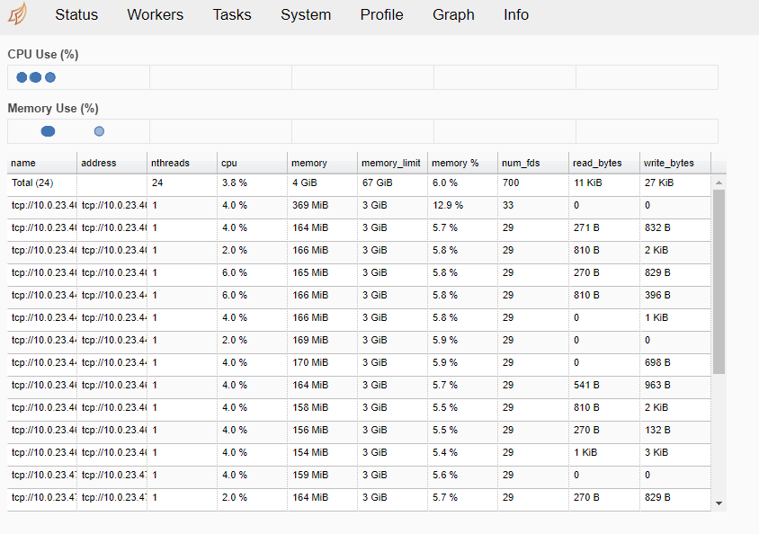
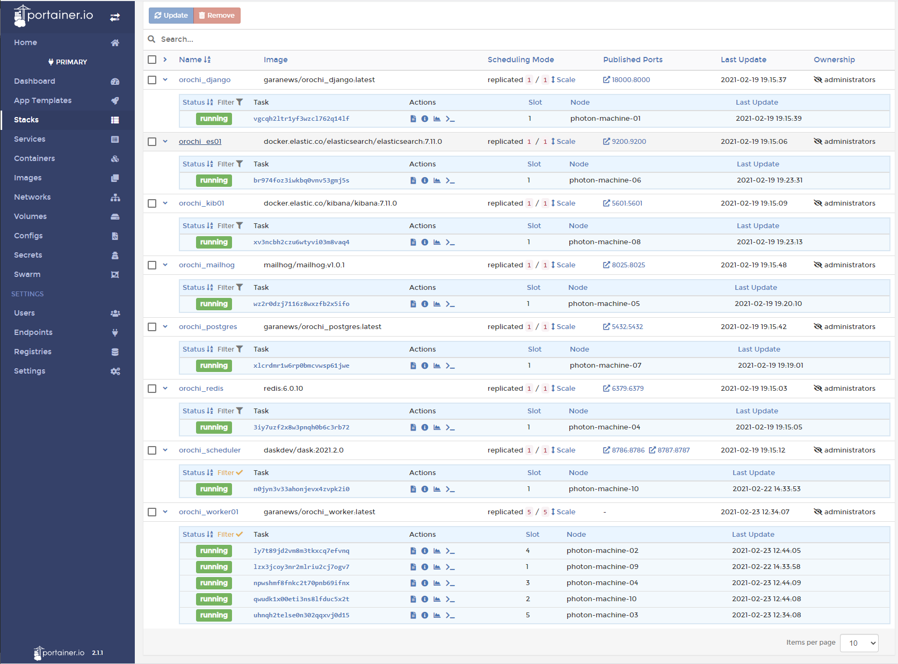

# Orochi Docker Swarm Deployment Guide

_Multi-Node Horizontal Scaling for Distributed Memory Forensics_

---

## Table of Contents

- [Concepts](#concepts)
- [Prerequisites](#prerequisites)
- [Get Started with Swarm Mode](#get-started-with-swarm-mode)
  - [1. Initialize the Swarm](#1-initialize-the-swarm)
  - [2. Join Worker Nodes](#2-join-worker-nodes)
  - [3. Deploy the Orochi Stack](#3-deploy-the-orochi-stack)
  - [4. Scale Dask Workers](#4-scale-dask-workers)
- [Shared File System (NFS)](#shared-file-system-nfs)
- [Managing the Swarm with Portainer](#managing-the-swarm-with-portainer)

---

## Concepts

Using [Docker Swarm mode](https://docs.docker.com/engine/swarm/), you can horizontally scale Orochi memory analysis across multiple physical servers or cloud VMs. A Swarm cluster consists of **manager** nodes (orchestration and scheduling) and **worker** nodes (executing Volatility 3 plugins via Dask).

---

## Prerequisites

1. **Docker Engine** installed on every manager and worker host, with network reachability on Swarm ports (`2377/tcp`, `7946/tcp+udp`, `4789/udp`).
2. **Environment file**: `.envs/.local/.django` must exist with a unique `DJANGO_SECRET_KEY` (Orochi refuses to start without it).
3. **Shared NFS Storage**: All nodes must be able to mount the shared NFS directories defined in `docker-compose-swarm.yml` (see [Shared File System (NFS)](#shared-file-system-nfs)).

---

## Get Started with Swarm Mode

### 1. Initialize the Swarm

On the first manager node, initialize the Swarm cluster:

```bash
docker swarm init
```

Docker prints a `docker swarm join --token ...` command to add additional nodes.

### 2. Join Worker Nodes

Run the join command on each additional host:

```bash
docker swarm join --token <SWARM_JOIN_TOKEN> <MANAGER_IP>:2377
```

Verify cluster membership from any manager node:

```bash
docker node ls
```

```text
ID                            HOSTNAME            STATUS    AVAILABILITY   MANAGER STATUS   ENGINE VERSION
jh91w3zjh2c5xrqu8qp35rles *   photon-machine-01   Ready     Active         Reachable        24.0.7
a1y9af9xax4npkfs3fb73736j     photon-machine-02   Ready     Active         Reachable        24.0.7
slzalzsat84rq8vrlht0pdr8g     photon-machine-03   Ready     Active         Leader           24.0.7
...
```

### 3. Deploy the Orochi Stack

Before deploying, replace `nfs_server_ip` in `docker-compose-swarm.yml` with your NFS server's IP address.

> **Security & Performance Defaults in `docker-compose-swarm.yml`:**
> - Internal services (`postgres`, `redis`, `mailpit`, `scheduler`, `ollama`) do **not** publish ports on Swarm ingress; they communicate exclusively over the internal overlay network. Only `nginx` exposes ports `80` and `443`.
> - `postgres` (`pg_isready`) and `redis` (`redis-cli ping`) include built-in Docker Swarm `healthcheck` definitions.
> - `django_wsgi` sets `TAILWIND_WATCH=0` and `COLLECTSTATIC_ON_START=0` for fast startup on Swarm nodes.

Deploy the stack:

```bash
docker stack deploy -c docker-compose-swarm.yml orochi
```

Check service placement and status:

```bash
docker stack ps orochi
```

```text
ID             NAME                     IMAGE                                   NODE                DESIRED STATE   CURRENT STATE
vgcqh2ltr1yf   orochi_django_wsgi.1     ghcr.io/ldo-cert/orochi_django:latest   photon-machine-01   Running         Running 3 days ago
wz2r0dzj7116   orochi_mailpit.1         axllent/mailpit:latest                  photon-machine-05   Running         Running 3 days ago
xlcrdmr1w6rp   orochi_postgres.1        postgres:17.4                           photon-machine-07   Running         Running 3 days ago
3iy7uzf2x8w3   orochi_redis.1           redis:7.4.2                             photon-machine-04   Running         Running 3 days ago
n0jyn3v33aho   orochi_scheduler.1       ghcr.io/ldo-cert/orochi_worker:latest   photon-machine-10   Running         Running 22 hours ago
lzx3jcoy3nr2   orochi_worker.1          ghcr.io/ldo-cert/orochi_worker:latest   photon-machine-09   Running         Running 22 hours ago
```

### 4. Scale Dask Workers

Scale the `worker` service to distribute Volatility 3 jobs across nodes:

```bash
docker service scale orochi_worker=5
```

```text
orochi_worker scaled to 5
overall progress: 5 out of 5 tasks
1/5: running   [==================================================>]
...
verify: Service converged
```

No additional configuration is required: each new worker automatically registers with `orochi_scheduler` over the overlay network.



---

## Shared File System (NFS)

Both the Django containers and every Dask worker require shared access to uploaded dumps, symbol tables, custom plugins, YARA rules, and Volatility caches. In single-host `docker-compose.yml`, named Docker volumes handle this locally:

```yaml
volumes:
  - media_path:/media
  - symbols_path:/symbols
  - plugin_path:/plugins
  - yara_path:/yara
  - cache_path:/root/.cache/volatility3
```

In a multi-node Swarm cluster, configure an **NFSv4 share** (for example, following [DigitalOcean's Ubuntu NFS setup guide](https://www.digitalocean.com/community/tutorials/how-to-set-up-an-nfs-mount-on-ubuntu-20-04)) and point the volumes in `docker-compose-swarm.yml` (`media_path`, `symbols_path`, `plugin_path`, `yara_path`, `cache_path`, `clamav_path`, `postgres_data`, `postgres_backups`, `ollama_data`) to your NFS server:

```yaml
volumes:
  media_path:
    driver: local
    driver_opts:
      type: "nfs"
      o: "addr=nfs_server_ip,nolock,soft,rw,nfsvers=4"
      device: ":/var/nfs/media"
  symbols_path:
    driver: local
    driver_opts:
      type: "nfs"
      o: "addr=nfs_server_ip,nolock,soft,rw,nfsvers=4"
      device: ":/var/nfs/symbols"
  plugin_path:
    driver: local
    driver_opts:
      type: "nfs"
      o: "addr=nfs_server_ip,nolock,soft,rw,nfsvers=4"
      device: ":/var/nfs/plugin"
  yara_path:
    driver: local
    driver_opts:
      type: "nfs"
      o: "addr=nfs_server_ip,nolock,soft,rw,nfsvers=4"
      device: ":/var/nfs/yara"
  cache_path:
    driver: local
    driver_opts:
      type: "nfs"
      o: "addr=nfs_server_ip,nolock,soft,rw,nfsvers=4"
      device: ":/var/nfs/cache"
  clamav_path:
    driver: local
    driver_opts:
      type: "nfs"
      o: "addr=nfs_server_ip,nolock,soft,rw,nfsvers=4"
      device: ":/var/nfs/clamav"
  postgres_data:
    driver: local
    driver_opts:
      type: "nfs"
      o: "addr=nfs_server_ip,nolock,soft,rw,nfsvers=4"
      device: ":/var/nfs/postgres/data"
  postgres_backups:
    driver: local
    driver_opts:
      type: "nfs"
      o: "addr=nfs_server_ip,nolock,soft,rw,nfsvers=4"
      device: ":/var/nfs/postgres/backups"
```

---

## Managing the Swarm with Portainer

[Portainer](https://www.portainer.io/) provides a web UI to inspect nodes, scale replicas, and tail container logs across your Swarm cluster. Deploy Portainer and its Swarm agent from a manager node:

```bash
curl -L https://downloads.portainer.io/portainer-agent-stack.yml -o portainer-agent-stack.yml
docker stack deploy -c portainer-agent-stack.yml portainer
```



---

© 2026 LDO-CERT — Collaborative Memory Forensics Platform
